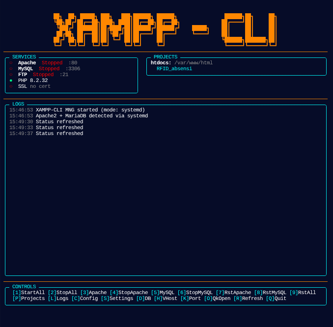

<p align="center">
  
</p>

<h1 align="center">🖥️ XAMPP CLI Manager</h1>

<p align="center">
  <b>Interactive terminal-based XAMPP control panel — lightweight, zero external dependencies.</b>
</p>

<p align="center">
  
  
  
  
</p>

---

## 📋 Table of Contents

- [Features](#-features)
- [Screenshot](#-screenshot)
- [System Requirements](#-system-requirements)
- [Installation](#-installation)
- [Usage](#-usage)
- [Key Bindings](#-key-bindings)
- [Feature Details](#-feature-details)
- [Project Structure](#-project-structure)
- [Configuration](#-configuration)
- [Troubleshooting](#-troubleshooting)
- [License](#-license)

---

## ✨ Features

| Feature | Description |
|---------|-------------|
| **Service Control** | Start / Stop / Restart Apache, MySQL, FTP (individual or all) |
| **Dual Mode** | Auto-detects native XAMPP (`/opt/lampp`) or systemd (apache2/mariadb) |
| **Project Manager** | Copy / symlink / remove projects from source folder to htdocs |
| **Database Browser** | List MySQL databases with sizes, phpMyAdmin shortcut |
| **Virtual Host Manager** | Parse vhost config files, restart Apache |
| **Port Checker** | Check ports 80, 3306, 443, 21 with PID and process info |
| **Quick Config Editor** | Edit php.ini, httpd.conf, my.cnf directly via `nano` / `vi` |
| **Quick Open** | Quick access to phpMyAdmin, htdocs, XAMPP folder, Apache log, MySQL log |
| **Log Viewer** | Real-time action history with timestamps |
| **Persistence** | Configuration saved automatically to `~/.config/xampp-cli.json` |
| **Zero Dependencies** | Uses only Node.js built-in modules |

---

## 🖼️ Screenshot

<p align="center">
  
</p>

---

## 🔧 System Requirements

### Required
| Software | Minimum | Notes |
|----------|---------|-------|
| **Node.js** | v18+ | ES Modules support (`import`) |
| **OS** | Linux / macOS | XAMPP or Apache2+MariaDB installed |

### Optional (for specific features)
| Software | Used for |
|----------|----------|
| `sudo` | Running start/stop/restart service commands |
| `nano` / `vi` | Editing configuration files |
| `mysql` (CLI) | Listing databases and sizes |
| `openssl` | Checking SSL certificate info |
| `ss` (iproute2) | Checking port usage |
| `hostname -I` | Detecting local IP |

---

## 📦 Installation

### 1. Clone or download

```bash
git clone https://github.com/IKInecro/xampp-cli-mng.git
cd xampp-cli-mng
```

### 2. Install globally (optional)

To run as `xampp` from anywhere:

```bash
npm install -g .
```

Or run directly:

```bash
node index.js
```

---

## 🚀 Usage

Run from terminal:

```bash
xampp
```

If not installed globally:

```bash
node index.js
```

### Quick Start

1. Run `xampp` — dashboard auto-detects XAMPP or systemd
2. Press `[3]` to start Apache, `[5]` to start MySQL
3. If not detected, press `[S]` to set XAMPP path manually
4. Press `[1]` to start all services at once

---

## ⌨️ Key Bindings

### Service Control

| Key | Action |
|-----|--------|
| `1` | Start All Services |
| `2` | Stop All Services |
| `3` | Start Apache |
| `4` | Stop Apache |
| `5` | Start MySQL |
| `6` | Stop MySQL |
| `7` | Restart Apache |
| `8` | Restart MySQL |
| `9` | Restart All |

### Navigation

| Key | View |
|-----|------|
| `P` | **Projects** — manage source ↔ htdocs projects |
| `L` | **Logs** — view action history |
| `C` | **Config** — edit config files (php.ini, httpd.conf, etc.) |
| `S` | **Settings** — change XAMPP path / source folder |
| `D` | **Database** — browse MySQL databases |
| `H` | **Virtual Host** — view and restart vhosts |
| `K` | **Port Checker** — check in-use ports |
| `O` | **Quick Open** — quick access to folders/logs |
| `R` | **Refresh** — refresh service status |
| `Q` | **Quit** — exit application |

### In Sub-Views

| Key | Action |
|-----|--------|
| `↑` / `↓` | Navigate items |
| `Enter` | Select / open |
| `Esc` / `Q` | Return to dashboard |
| `L` (Projects) | Symlink project to htdocs |
| `R` (Projects) | Remove project from htdocs |
| `R` (DB/Port) | Refresh data |
| `A` (VHost) | Add virtual host |
| `D` (VHost) | Delete virtual host |

---

## 🧩 Feature Details

### 📁 Project Manager
Manage projects from source folder (default: `~/jawa`) to `htdocs`:
- **Copy** — copy project folder to htdocs
- **Symlink** — create symbolic link (saves disk space)
- **Remove** — delete project from htdocs
- When Apache starts, project links are automatically shown in logs (clickable!)

### 🗄️ Database Browser
Lists all MySQL databases (excluding `performance_schema` & `information_schema`) with sizes in MB. Press `Enter` to get a phpMyAdmin link.

### 🌐 Virtual Host Manager
Reads vhost config files (`httpd-vhosts.conf`, `httpd.conf`) and displays domain + document root. Restart Apache directly from this view.

### 🔌 Port Checker
Checks if ports 80 (Apache), 3306 (MySQL), 443 (HTTPS), 21 (FTP) are in use, with PID and process name.

### ⚡ Quick Config
Edit important config files via `nano`:
- `php.ini`
- `httpd.conf`
- `my.cnf`
- `proftpd.conf`
- `phpMyAdmin config.inc.php`

### 🚀 Quick Open
Quick access to:
- phpMyAdmin (http://localhost/phpmyadmin)
- htdocs folder
- XAMPP folder
- Apache access log
- MySQL error log
- PHP info page

---

## 📁 Project Structure

```
xampp/
├── index.js           # Main entry point (ESM)
├── package.json       # Package metadata & binary config
├── README.md          # This documentation
├── .gitignore         # Git ignore rules
└── asset/
    └── imange.png     # Screenshot for README
```

### Main File: `index.js`

Single-file application (~1260 lines) with this structure:

```
📄 index.js
├── Constants & Config
├── ANSI Color Utilities
├── Persistence (loadConfig / saveConfig)
├── Logging System
├── Service Detection (XAMPP / systemd)
├── Service Control (start / stop / restart)
├── Project Manager (copy / link / remove)
├── Feature Helpers (PHP, SSL, DB, VHost, Port)
├── Panel Renderers (Dashboard, Projects, DB, etc.)
├── Input Handler (onKey)
└── Main Lifecycle
```

---

## ⚙️ Configuration

Configuration is saved at `~/.config/xampp-cli.json`:

```json
{
  "xamppDir": "/opt/lampp",
  "projectSource": "/home/jawa",
  "htdocsDir": "/opt/lampp/htdocs",
  "svcMode": "xampp"
}
```

### Adjustable settings via `[S]ettings`:
1. **Set XAMPP path** — change XAMPP installation location
2. **Set Source folder** — folder where projects are stored
3. **Auto-detect services** — re-detect XAMPP / systemd

---

## 🔍 Troubleshooting

### "XAMPP not detected"
- Make sure XAMPP is installed at `/opt/lampp` or another standard path
- Press `[S]` → `[1]` to set path manually
- Or if using native Apache2/MariaDB, press `[3]` Auto-detect

### "Permission denied" when starting/stopping services
- Make sure your user has `sudo` access
- Run `sudo -v` first to cache sudo credentials

### MySQL not showing up
- Make sure MySQL/MariaDB is running
- If using a root password, run `mysql` first to set up the user

### Port 80/3306 already in use
- Use `[K]` Port Checker to see which process is using the port
- Stop other services using the same port

### Terminal display broken
- The app automatically cleans up on exit (Ctrl+C / Q)
- If force-closed, run `reset` in your terminal

---

## 📄 License

MIT License — free to use, modify, and distribute.

---

<p align="center">
  Made with ❤️ by <a href="https://github.com/IKInecro">IKInecro</a>
</p>
